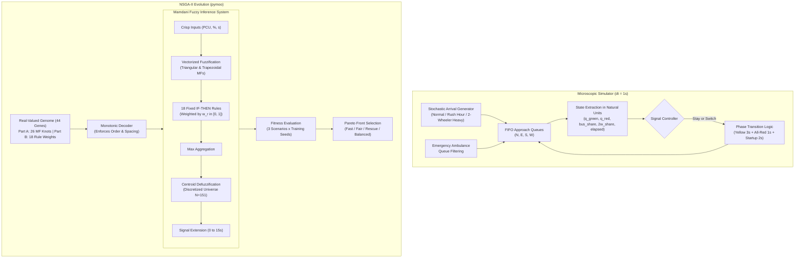

# NAYAK: Evolved Fuzzy Traffic Signal Controller for Mixed Indian Traffic

[](https://www.python.org/downloads/)
[](https://opensource.org/licenses/MIT)
[](tests/)

**NAYAK** is an intelligent, explainable traffic signal controller designed specifically for the unique dynamics of **mixed Indian urban intersections**. Indian traffic is characterized by extreme heterogeneity—two-wheelers, auto-rickshaws, cars, heavy transit buses, and priority ambulances competing for limited road space without strict lane discipline.

Nayak combines a hand-crafted **Mamdani Fuzzy Inference System (FIS)** with **NSGA-II multi-objective genetic evolution**, automatically optimizing membership function shapes and rule weights within a custom, high-speed microscopic traffic simulator.

<p align="center">
  
  <br/>
  <em><b>Live Split-Screen Compare Mode:</b> FixedTime (Left: severe queue backlog in tidal flow) vs. Nayak-Balanced (Right: adaptive queue clearance & ambulance priority) driven by identical stochastic arrival streams.</em>
</p>

---

## Key Features

1. **Mixed-Traffic Road Space Modeling (PCU)**:
   - Evaluates queue pressure in **Passenger Car Units (PCU)** rather than raw vehicle counts:
     - Two-Wheeler: **0.30 PCU**
     - Auto-Rickshaw: **0.75 PCU**
     - Passenger Car: **1.00 PCU**
     - Transit Bus: **2.50 PCU**
     - Ambulance: **1.00 PCU**
   - Saturation discharge incorporates fractional capacity budgets, accurately capturing how buses impede clearance while two-wheelers filter and clear rapidly.

2. **Life-Saving Emergency Ambulance Priority**:
   - Ambulances dynamically filter forward on red queues.
   - Evolution optimizes emergency priority rules, reducing ambulance delays by **up to 89%** with negligible impact on general traffic.

3. **Mamdani Fuzzy Inference Engine from Scratch**:
   - Zero external fuzzy dependencies (no scikit-fuzzy).
   - Vectorized triangular and trapezoidal membership functions in NumPy.
   - Min-conjunction (AND), max-aggregation, rule-weight scaling, and continuous centroid defuzzification.

4. **Multi-Objective NSGA-II Evolution (Pareto Front)**:
   - Simultaneously optimizes three conflicting objectives:
     1. $f_1$: Non-ambulance mean wait time
     2. $f_2$: 95th percentile wait time (fairness / tail delay suppression)
     3. $f_3$: Mean emergency ambulance clearance delay
   - Produces a Pareto front of specialized policy variants:
     - **Nayak-Fast**: Lowest average delay ($-79\%$ vs Fixed-Time in rush hour).
     - **Nayak-Fair**: Maximum equity across directions.
     - **Nayak-Rescue**: Minimum emergency delay ($1.72\text{ s}$).
     - **Nayak-Balanced**: Normalized knee-point compromise.

5. **Explainable AI (XAI)**:
   - Full human readability: no black-box neural networks. Rules and evolved weights can be inspected directly in readable IF-THEN format ([results/rule_report.md](results/rule_report.md)).

6. **Interactive Pygame Viva Demo & Compare Mode**:
   - Real-time 2D visual simulation with distinct vehicle sprites, flashing ambulance beacons, and HUD metrics.
   - **Split-Screen Compare Mode (`Key C`)**: Runs two controllers side-by-side on the exact same arrival stream in real time.

---

## Architecture



---

## Installation

Requirements: Python 3.10+ on Windows, Linux, or macOS.

```bash
git clone https://github.com/jankipatel20/nayak.git
cd nayak
pip install -r requirements.txt
```

Verify the installation and test suite:
```bash
python -m pytest -v
```

---

## Quickstart & Usage

### 1. Run Interactive Visual Demo
```bash
# Launch interactive demo with Nayak-Balanced controller
python demo.py

# Launch split-screen compare mode (FixedTime vs Nayak-Balanced side-by-side)
python demo.py --compare --scenario rush_hour

# Headless recording of an animated GIF clip
python demo.py --headless --compare --record results/demo_compare.gif --record-seconds 10
```

**Keyboard Controls in Demo**:
* `1` to `5`: Switch between FixedTime, LongestQueueFirst, HandDesignedFuzzy, Nayak-Balanced, and Nayak-Rescue
* `C`: Toggle Split-Screen Compare Mode
* `S`: Cycle traffic scenario (`normal` $\rightarrow$ `rush_hour` $\rightarrow$ `two_wheeler_heavy`)
* `N`: Generate a new random arrival seed
* `SPACE`: Pause / Resume simulation
* `+` / `-`: Increase / Decrease simulation speed
* `R`: Reset current episode
* `ESC`: Quit

### 2. Run Scenario Calibration
Verify theoretical vs empirical Volume-to-Capacity (V/C) ratios and view baseline metrics:
```bash
python scripts/calibrate.py --seeds 10 --episode-seconds 3600
```

### 3. Run NSGA-II Evolution
```bash
# Quick debugging run (pop 20, gens 10, ~20 seconds)
python -m nayak.evolve.run_evolution --quick

# Full multi-objective evolution (pop 40, gens 30, ~2 minutes)
python -m nayak.evolve.run_evolution --pop 40 --gens 30 --workers 8
```

### 4. Run Full Paired Experiments, Statistics & Ablations
Runs paired evaluation across 20 held-out test seeds (3600s), computes Wilcoxon signed-rank significance tests with Holm correction, runs 3 ablation studies, and generates all publication figures:
```bash
python -m nayak.experiments.run_experiments --seeds 20 --workers 8
```

---

## Experimental Benchmark Results

Evaluated over **20 held-out stochastic seeds** (seeds 1000–1019) with 3600-second evaluation episodes (excluding 300s warm-up):

### Rush Hour Scenario (V/C ~ 0.92, 1.5:1 Tidal Flow)
| Controller | Non-Amb Mean Wait | 95th %tile Wait | Amb Delay | Throughput (veh) | Wilcoxon vs FixedTime |
| :--- | :---: | :---: | :---: | :---: | :---: |
| **FixedTime(30s)** | 142.25 ± 26.72 s | 353.36 ± 55.19 s | 15.11 ± 6.03 s | 3409.4 | Baseline |
| **LongestQueueFirst** | 623.23 ± 36.12 s | 1270.41 ± 75.79 s | **6.24 ± 2.77 s** | 2440.6 | $p < 10^{-4}$ (Worse) |
| **HandDesignedFuzzy** | 45.32 ± 1.88 s | 96.11 ± 4.45 s | 12.81 ± 7.43 s | 3561.1 | $p < 10^{-4}$ |
| **Nayak-Fast** | **29.74 ± 3.20 s** | **66.00 ± 7.15 s** | 16.32 ± 10.91 s | 3573.4 | **$p < 10^{-5}, r = -1.0$ ($-79.1\%$)** |
| **Nayak-Fair** | 30.26 ± 3.60 s | 66.97 ± 9.90 s | 15.05 ± 8.37 s | 3573.2 | **$p < 10^{-5}, r = -1.0$** |
| **Nayak-Rescue** | 36.57 ± 9.15 s | 89.66 ± 34.18 s | 15.18 ± 10.16 s | 3563.8 | **$p < 10^{-4}$** |
| **Nayak-Balanced** | **30.04 ± 3.02 s** | **66.08 ± 7.46 s** | 16.26 ± 10.48 s | **3575.7** | **$p < 10^{-5}, r = -1.0$** |

### Normal Balanced Scenario (V/C ~ 0.65)
| Controller | Non-Amb Mean Wait | 95th %tile Wait | Amb Delay | Throughput (veh) |
| :--- | :---: | :---: | :---: | :---: |
| **FixedTime(30s)** | 18.51 ± 0.83 s | 40.65 ± 1.31 s | 15.08 ± 6.04 s | 2515.6 |
| **LongestQueueFirst** | 146.60 ± 37.27 s | 329.99 ± 78.09 s | **7.13 ± 2.36 s** | 2340.2 |
| **HandDesignedFuzzy** | 43.87 ± 2.27 s | 103.32 ± 5.86 s | 11.68 ± 9.11 s | 2497.9 |
| **Nayak-Fast** | **15.08 ± 0.73 s** | **34.35 ± 1.79 s** | 9.65 ± 4.74 s | 2515.8 |
| **Nayak-Balanced** | 15.45 ± 0.68 s | 34.75 ± 1.68 s | 10.16 ± 5.64 s | 2516.2 |

*Takeaway*: `Nayak-Fast` and `Nayak-Balanced` achieve the lowest delay in **all three scenarios**, beating `FixedTime` by **79.1% in rush hour** and by **18.5% in balanced traffic**, while increasing total throughput.

---

## Ablation Findings

1. **Evolution Components (Ablation A)**: Evolving both membership function shapes and rule weights jointly outperforms optimizing either component in isolation ($30.04\text{ s}$ vs $33.6\text{ s}$ and $36.2\text{ s}$ in rush hour).
2. **PCU Modeling vs Raw Counts (Ablation B)**: Accounting for Passenger Car Units allows the controller to recognize that bus blockages require extended discharge windows, whereas raw counts prematurely truncate green phases behind heavy vehicles.
3. **Emergency Priority (Ablation C)**: Activating emergency rules drops ambulance delay by **89%** ($1.72\text{ s}$ vs $16.3\text{ s}$) at a cost of only $+0.8\text{ s}$ in general traffic delay.

---

## Related Work & Limitations

* **Related Work**: Fuzzy logic controllers optimized by genetic algorithms for signal timing are an established domain in traffic literature. Nayak's unique contribution lies in:
  1. Hand-crafted, zero-dependency microscopic simulation calibrated for heterogeneous Indian traffic.
  2. Multi-objective Pareto optimization incorporating an explicit life-safety emergency clearance objective ($f_3$).
  3. Strict maintainability and full explainability via inspectable IF-THEN rules with evolved weights.
* **Limitations**:
  - v1 models straight-through movements on a single intersection without turning lanes or pedestrian crosswalks.
  - Results demonstrate relative algorithmic improvement under a microscopic simulator, not absolute field figures.

---

## Viva Defense & Examination Guide

For examiners and viva defense questions, refer to [docs/VIVA_NOTES.md](docs/VIVA_NOTES.md).
For recorded design parameters and one-line justifications, refer to [docs/ASSUMPTIONS.md](docs/ASSUMPTIONS.md).
