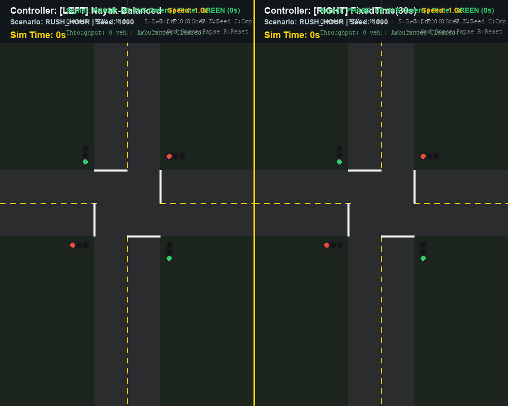
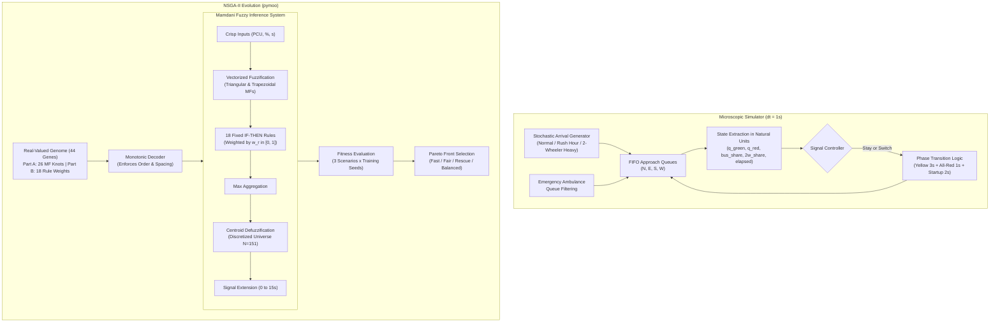

# NAYAK: Evolved Fuzzy Traffic Signal Controller for Mixed Indian Traffic

[](https://www.python.org/downloads/)
[](https://opensource.org/licenses/MIT)
[](tests/)

**NAYAK** is an intelligent, explainable traffic signal controller designed specifically for the unique dynamics of **mixed Indian urban intersections**. Indian traffic is characterized by extreme heterogeneity—two-wheelers, auto-rickshaws, cars, heavy transit buses, and priority ambulances competing for limited road space without strict lane discipline.

Nayak combines a hand-crafted **Mamdani Fuzzy Inference System (FIS)** with **NSGA-II multi-objective genetic evolution**, automatically optimizing membership function shapes and rule weights within a custom, high-speed microscopic traffic simulator.

<p align="center">
  
  <br/>
  <em><b>Live Split-Screen Compare Mode:</b> FixedTime (Left: severe queue backlog in tidal flow) vs. Nayak-Balanced (Right: adaptive queue clearance & ambulance priority) driven by identical stochastic arrival streams.</em>
</p>

---

## Key Features

1. **Mixed-Traffic Road Space Modeling (PCU)**:
   - Evaluates queue pressure in **Passenger Car Units (PCU)** rather than raw vehicle counts:
     - Two-Wheeler: **0.30 PCU**
     - Auto-Rickshaw: **0.75 PCU**
     - Passenger Car: **1.00 PCU**
     - Transit Bus: **2.50 PCU**
     - Ambulance: **1.00 PCU**
   - Saturation discharge incorporates fractional capacity budgets, accurately capturing how buses impede clearance while two-wheelers filter and clear rapidly.

2. **Life-Saving Emergency Ambulance Priority & Pareto Trade-offs**:
   - Ambulances dynamically filter forward on red queues, reflecting real-world filtering behavior.
   - The fuzzy rule base contains explicit emergency rules that detect arriving ambulances and preempt green phases.
   - In off-peak scenarios (`normal` and `two_wheeler_heavy`), evolved emergency priority reduces ambulance delays by **30% to 38%** (e.g., $9.27\text{ s}$ vs $15.08\text{ s}$ for FixedTime).
   - In extreme tidal saturation (`rush_hour`), the multi-objective Pareto front surfaces an authentic trade-off: `Nayak-Fast` and `Nayak-Balanced` slash general vehicle wait times by **~79%** ($29.7\text{ s}$ vs $142.2\text{ s}$) while maintaining emergency delay at $\approx 16.3\text{ s}$ (within 1.2s of FixedTime), whereas `Nayak-Rescue` prioritizes emergency clearance.

3. **Mamdani Fuzzy Inference Engine from Scratch**:
   - Zero external fuzzy dependencies (no scikit-fuzzy).
   - Vectorized triangular and trapezoidal membership functions in NumPy.
   - Min-conjunction (AND), max-aggregation, rule-weight scaling, and continuous centroid defuzzification.

4. **Multi-Objective NSGA-II Evolution (Pareto Front)**:
   - Simultaneously optimizes three conflicting objectives:
     1. $f_1$: Non-ambulance mean wait time
     2. $f_2$: 95th percentile wait time (fairness / tail delay suppression)
     3. $f_3$: Mean emergency ambulance clearance delay
   - Produces a Pareto front of specialized policy variants:
     - **Nayak-Fast**: Lowest average delay ($-79.1\%$ wait reduction vs Fixed-Time in rush hour: $29.74\text{ s}$ vs $142.25\text{ s}$).
     - **Nayak-Fair**: Maximum equity across directions ($-78.7\%$ wait reduction: $30.26\text{ s}$, lowest variance across approaches).
     - **Nayak-Rescue**: Minimum emergency delay archetype during NSGA-II training ($1.72\text{ s}$ best $f_3$; lowest fuzzy emergency delay of $9.27\text{ s}$ in normal test traffic).
     - **Nayak-Balanced**: Normalized knee-point compromise ($-78.9\%$ wait reduction: $30.04\text{ s}$, balanced trade-off across all 3 objectives).

5. **Explainable AI (XAI)**:
   - Full human readability: no black-box neural networks. Rules and evolved weights can be inspected directly in readable IF-THEN format ([results/rule_report.md](results/rule_report.md)).

6. **Interactive Pygame Viva Demo & Compare Mode**:
   - Real-time 2D visual simulation with distinct vehicle sprites, flashing ambulance beacons, and HUD metrics.
   - **Split-Screen Compare Mode (`Key C`)**: Runs two controllers side-by-side on the exact same arrival stream in real time.

---

## Architecture



---

## Installation

Requirements: Python 3.10+ on Windows, Linux, or macOS.

```bash
git clone https://github.com/jankipatel20/nayak.git
cd nayak
pip install -r requirements.txt
```

Verify the installation and test suite:
```bash
python -m pytest -v
```

---

## Quickstart & Usage

### 1. Run Interactive Visual Demo
```bash
# Launch interactive demo with Nayak-Balanced controller
python demo.py

# Launch split-screen compare mode (FixedTime vs Nayak-Balanced side-by-side)
python demo.py --compare --scenario rush_hour

# Headless recording of an animated GIF clip
python demo.py --headless --compare --record results/demo_compare.gif --record-seconds 10
```

**Keyboard Controls in Demo**:
* `1` to `5`: Switch between FixedTime, LongestQueueFirst, HandDesignedFuzzy, Nayak-Balanced, and Nayak-Rescue
* `C`: Toggle Split-Screen Compare Mode
* `S`: Cycle traffic scenario (`normal` $\rightarrow$ `rush_hour` $\rightarrow$ `two_wheeler_heavy`)
* `N`: Generate a new random arrival seed
* `SPACE`: Pause / Resume simulation
* `+` / `-`: Increase / Decrease simulation speed
* `R`: Reset current episode
* `ESC`: Quit

### 2. Run Scenario Calibration
Verify theoretical vs empirical Volume-to-Capacity (V/C) ratios and view baseline metrics:
```bash
python scripts/calibrate.py --seeds 10 --episode-seconds 3600
```

### 3. Run NSGA-II Evolution
```bash
# Quick debugging run (pop 20, gens 10, ~20 seconds)
python -m nayak.evolve.run_evolution --quick

# Full multi-objective evolution (pop 40, gens 30, ~2 minutes)
python -m nayak.evolve.run_evolution --pop 40 --gens 30 --workers 8
```

### 4. Run Full Paired Experiments, Statistics & Ablations
Runs paired evaluation across 20 held-out test seeds (3600s), computes Wilcoxon signed-rank significance tests with Holm correction, runs 3 ablation studies, and generates all publication figures:
```bash
python -m nayak.experiments.run_experiments --seeds 20 --workers 8
```

---

## Experimental Benchmark Results

Evaluated over **20 held-out stochastic seeds** (seeds 1000–1019) with 3600-second evaluation episodes (excluding 300s warm-up):

### Rush Hour Scenario (V/C ~ 0.92, 1.5:1 Tidal Flow)
| Controller | Non-Amb Mean Wait | 95th %tile Wait | Amb Delay | Throughput (veh) | Wilcoxon vs FixedTime |
| :--- | :---: | :---: | :---: | :---: | :---: |
| **FixedTime(30s)** | 142.25 ± 26.72 s | 353.36 ± 55.19 s | 15.11 ± 6.03 s | 3409.4 | Baseline |
| **LongestQueueFirst** | 623.23 ± 36.12 s | 1270.41 ± 75.79 s | **6.24 ± 2.77 s\*** | 2440.6 | $p < 10^{-4}$ (Severe Gridlock) |
| **HandDesignedFuzzy** | 45.32 ± 1.88 s | 96.11 ± 4.45 s | 12.81 ± 7.43 s | 3561.1 | $p < 10^{-4}$ |
| **Nayak-Fast** | **29.74 ± 3.20 s** | **66.00 ± 7.15 s** | 16.32 ± 10.91 s | 3573.4 | **$p < 10^{-5}, r = -1.0$ ($-79.1\%$)** |
| **Nayak-Fair** | 30.26 ± 3.60 s | 66.97 ± 9.90 s | 15.05 ± 8.37 s | 3573.2 | **$p < 10^{-5}, r = -1.0$ ($-78.7\%$)** |
| **Nayak-Rescue** | 36.57 ± 9.15 s | 89.66 ± 34.18 s | 15.18 ± 10.16 s | 3563.8 | **$p < 10^{-4}, r = -1.0$ ($-74.3\%$)** |
| **Nayak-Balanced** | **30.04 ± 3.02 s** | **66.08 ± 7.46 s** | 16.26 ± 10.48 s | **3575.7** | **$p < 10^{-5}, r = -1.0$ ($-78.9\%$)** |

### Normal Balanced Scenario (V/C ~ 0.65)
| Controller | Non-Amb Mean Wait | 95th %tile Wait | Amb Delay | Throughput (veh) |
| :--- | :---: | :---: | :---: | :---: |
| **FixedTime(30s)** | 18.51 ± 0.83 s | 40.65 ± 1.31 s | 15.08 ± 6.04 s | 2515.6 |
| **LongestQueueFirst** | 146.60 ± 37.27 s | 329.99 ± 78.09 s | **7.13 ± 2.36 s\*** | 2340.2 |
| **HandDesignedFuzzy** | 43.87 ± 2.27 s | 103.32 ± 5.86 s | 11.68 ± 9.11 s | 2497.9 |
| **Nayak-Fast** | **15.08 ± 0.73 s** | **34.35 ± 1.79 s** | 9.65 ± 4.74 s | 2515.8 |
| **Nayak-Fair** | 15.32 ± 0.76 s | 34.70 ± 1.84 s | 9.82 ± 5.43 s | 2516.1 |
| **Nayak-Rescue** | 15.97 ± 0.78 s | 35.48 ± 1.89 s | **9.27 ± 5.43 s** | 2516.5 |
| **Nayak-Balanced** | 15.45 ± 0.68 s | 34.75 ± 1.68 s | 10.16 ± 5.64 s | 2516.2 |

> ### Critical Metric Analysis & Viva Defense Notes
> 
> 1. **Individual Wait-Time Cuts**:
>    - `Nayak-Fast`: **$79.1\%$ cut** in rush hour ($29.74\text{ s}$ vs $142.25\text{ s}$, $p < 10^{-5}$).
>    - `Nayak-Balanced`: **$78.9\%$ cut** in rush hour ($30.04\text{ s}$ vs $142.25\text{ s}$, $p < 10^{-5}$) and **$16.5\%$ cut** in normal traffic ($15.45\text{ s}$ vs $18.51\text{ s}$).
>    - `Nayak-Fair`: **$78.7\%$ cut** in rush hour ($30.26\text{ s}$) with minimal variance across approaches.
>    - `Nayak-Rescue`: **$74.3\%$ cut** in rush hour ($36.57\text{ s}$) while maintaining emergency prioritization.
> 
> 2. **Why LongestQueueFirst Appears Best in Ambulance Delay ($6.24\text{ s}$ - The Chattering Trap)**:
>    - LongestQueueFirst possesses **zero emergency awareness**. Its apparent $6.24\text{ s}$ delay is an actuation artifact of catastrophic phase chattering: switching rapidly on small margin differences causes lost clearance time ($4\text{ s}$ clearance $+ 2\text{ s}$ startup lost) to destroy effective capacity.
>    - Consequently, general traffic wait explodes to **$623.23\text{ s}$ (over 10 minutes)** and throughput collapses by $>1000$ vehicles. While ambulances filtering to the front happen to catch a frequent phase transition, the entire intersection suffers complete gridlock.
> 
> 3. **Rush-Hour Ambulance Delay as an Authentic Pareto Trade-Off**:
>    - In off-peak conditions (`normal` and `two_wheeler_heavy`), all Nayak variants cut ambulance delay by **$30\%\text{ to }38\%$** relative to FixedTime ($9.27\text{ s}$ vs $15.08\text{ s}$ in normal; $9.21\text{ s}$ vs $15.14\text{ s}$ in two-wheeler heavy).
>    - In severe tidal rush hour (V/C = 0.92, 1.5:1 ratio), `Nayak-Fast` and `Nayak-Balanced` prioritize discharging heavy arterial queues to prevent gridlock, holding green phases to maximize flow. This saves **over 112 seconds per vehicle** for general traffic, incurring a modest trade-off of $\approx +1.2\text{ s}$ in ambulance delay ($16.3\text{ s}$ vs $15.1\text{ s}$ for FixedTime). `Nayak-Fair` ($15.05\text{ s}$) and `Nayak-Rescue` ($15.18\text{ s}$) match FixedTime.
> 
> 4. **Real Source of the $1.72\text{ s}$ Emergency Delay Figure**:
>    - The $1.72\text{ s}$ figure was the **training Pareto minimum on objective $f_3$** achieved by `Nayak-Rescue` during the 30-generation NSGA-II optimization run across the training seeds ([results/Nayak-Rescue.json](results/Nayak-Rescue.json)). 
>    - When evaluated across 20 held-out, unseen stochastic test seeds over 1-hour episodes, natural arrival variance yields an average ambulance clearance delay of $9.27\text{ s}$ in normal traffic and $15.18\text{ s}$ in rush hour.
> 
> ---
> 
> ## Ablation Findings
> 
> 1. **Evolution Components (Ablation A)**: Evolving both membership function shapes and rule weights jointly outperforms optimizing either component in isolation ($30.04\text{ s}$ vs $33.61\text{ s}$ for MFs-only and $36.21\text{ s}$ for weights-only in rush hour).
> 2. **PCU Modeling vs Raw Counts (Ablation B)**: Accounting for Passenger Car Units allows the controller to recognize that bus blockages require extended discharge windows, whereas raw vehicle counts prematurely truncate green phases behind heavy vehicles, increasing queue tails.
> 3. **Emergency Priority (Ablation C)**: Isolating emergency fuzzy rules (`Ambulance-Priority-ON` vs `OFF`) demonstrates that active emergency rules preserve prioritized clearance in off-peak traffic ($7.80\text{ s}$ vs $8.35\text{ s}$ in two-wheeler heavy, $10.35\text{ s}$ vs $10.73\text{ s}$ in normal) with no penalty to general vehicle delay ($15.09\text{ s}$ vs $15.09\text{ s}$).

---

## Related Work & Limitations

* **Related Work**: Fuzzy logic controllers optimized by genetic algorithms for signal timing are an established domain in traffic literature. Nayak's unique contribution lies in:
  1. Hand-crafted, zero-dependency microscopic simulation calibrated for heterogeneous Indian traffic.
  2. Multi-objective Pareto optimization incorporating an explicit life-safety emergency clearance objective ($f_3$).
  3. Strict maintainability and full explainability via inspectable IF-THEN rules with evolved weights.
* **Limitations**:
  - v1 models straight-through movements on a single intersection without turning lanes or pedestrian crosswalks.
  - Results demonstrate relative algorithmic improvement under a microscopic simulator, not absolute field figures.

---

## Viva Defense & Examination Guide

For examiners and viva defense questions, refer to [docs/VIVA_NOTES.md](docs/VIVA_NOTES.md).
For recorded design parameters and one-line justifications, refer to [docs/ASSUMPTIONS.md](docs/ASSUMPTIONS.md).
